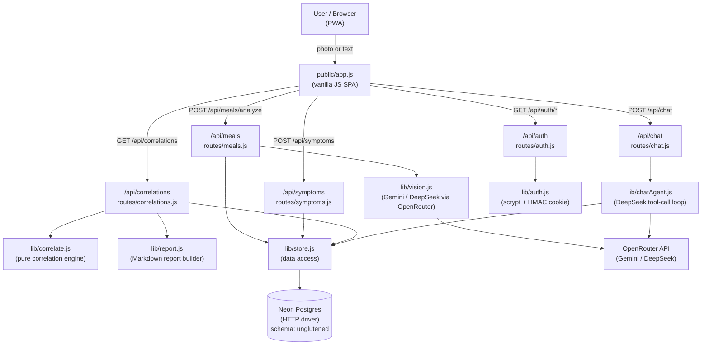
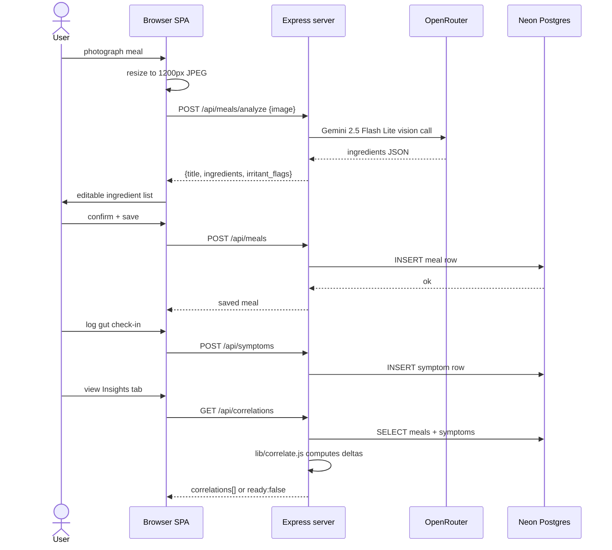
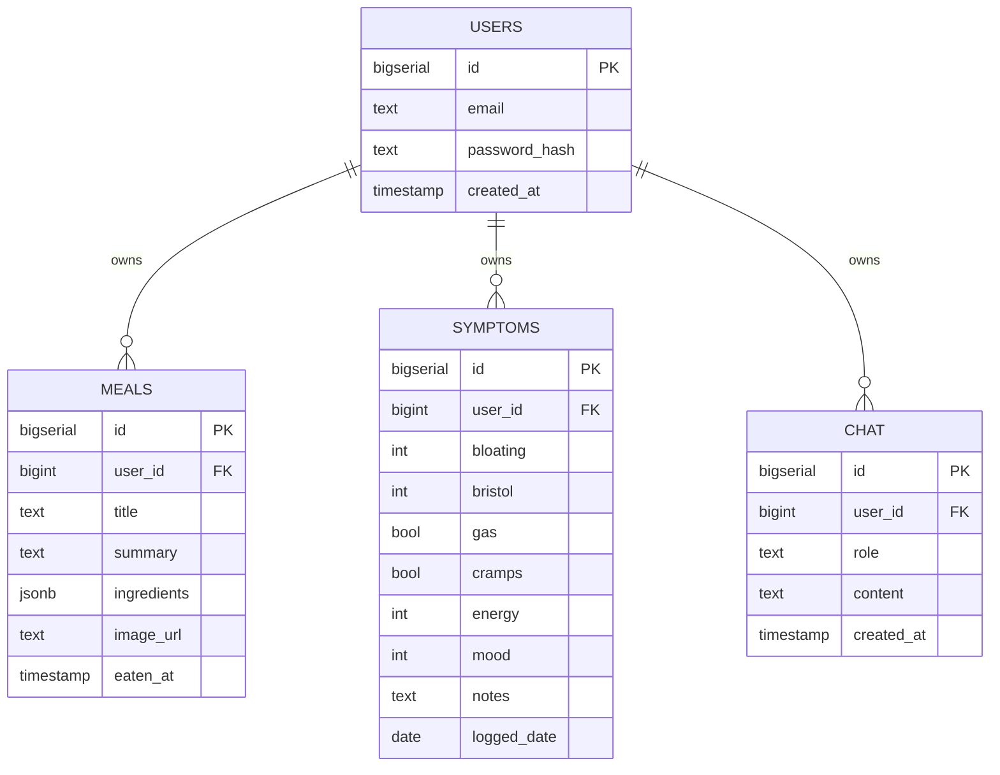

# UnGlutened

**A personal, mobile-first Progressive Web App that tracks food and gut health, extracts ingredients from meal photos via AI vision, and surfaces correlations between what you ate and how you felt.**

## Purpose

People with gut conditions (IBS, gluten intolerance, FODMAP sensitivities, etc.) struggle to identify trigger foods because the connection between a meal and symptoms is delayed and noisy. UnGlutened closes the loop: photograph a meal, get AI-extracted ingredients and irritant flags, log daily gut symptoms, and let the app compute statistically grounded correlations. A doctor-friendly report can be generated and shared. It is a single-user personal tool (now multi-account) deployed as a free-tier Render service.

## What it does

- Accepts meal photos or text descriptions and uses Gemini 2.5 Flash Lite (vision) or DeepSeek V4 Flash (text) to extract ingredients and flag 20 categories of digestive irritants (gluten, dairy, FODMAP, histamine, sorbitol, caffeine, etc.).
- Records daily gut-health check-ins: bloating (0–5), Bristol Stool Scale (1–7), gas, cramps, energy, mood.
- Computes per-ingredient / per-irritant correlation scores against gut symptom "badness", requiring ≥4 symptom days and ≥3 exposure days before showing any result (no fabricated data).
- Generates a Markdown doctor report (copy, download, or print).
- Provides an AI chatbot (DeepSeek V4 Flash, 11 tool-calling functions) that can query your log or add/edit/delete meals and gut entries by natural-language command.
- Installable as a PWA on iOS and Android (full-screen, 30-day session cookies).
- Fully multi-user: each account's data is isolated by `user_id` in Neon Postgres.

## How it works

The frontend is a single-page vanilla JS app (`public/index.html` + `public/app.js`, ~1200 lines). It renders 5 tabs: Log (meal entry), Gut (daily check-in), History (timeline), Insights (correlations + report), and Chat (AI assistant).

**Meal logging flow:** the user photographs a meal (resized to 1200px JPEG on a canvas) or types a description. The image or text is POSTed to `/api/meals/analyze`. `lib/vision.js` calls OpenRouter's Gemini endpoint for photo meals, or DeepSeek for text-only. The AI returns structured JSON (`title`, `summary`, `ingredients[]` with `name/category/irritant/irritant_type/confidence`). The frontend renders the ingredient list with editable irritant toggles. The user confirms and the meal is saved to Neon Postgres.

**Correlation flow:** `GET /api/correlations` loads all meals and symptom logs for the user. `lib/correlate.js` is a pure, DB-free engine that computes a "badness" composite score per symptom day (0–10), splits days into exposed/non-exposed per ingredient/irritant token, and computes a delta. It returns `ready:false` with a human reason string when there is insufficient data, and ranked correlations with `high/medium/low/protective` severity when there is enough.

**Chatbot flow:** `POST /api/chat` runs `lib/chatAgent.js`, a multi-turn tool-calling loop that issues up to 5 rounds of DeepSeek calls with 11 registered tools (query meals, query symptoms, add/edit/delete meals and symptoms, generate report, etc.). Tool results are accumulated and the final text answer is returned to the chat UI.

**Auth:** every account signs up with email + password. Passwords are hashed with `crypto.scryptSync`. Sessions are HMAC-SHA256 signed cookies (`ug_session`, 30-day expiry), parsed without any cookie library.

## Architecture





## Tech stack

| Layer | Technology |
|-------|-----------|
| Backend | Node.js 24 / Express (CommonJS, no build step) |
| Frontend | Vanilla HTML + CSS + JavaScript (SPA, no framework) |
| Data | Neon Postgres (serverless HTTP driver, `unglutened` schema) |
| LLM / AI | Gemini 2.5 Flash Lite (vision) + DeepSeek V4 Flash (text + chat) via OpenRouter |
| Auth | scrypt password hashing + HMAC-SHA256 signed session cookies |
| Hosting | **Cloudflare Pages + Pages Functions** (primary, since 2026-10-11 — never sleeps). Legacy Express/Render app (`server.js`) kept running (API/webhook callers only) and 302-redirects browser navigation to the Cloudflare URL. |
| PWA | Web App Manifest + Service Worker (network-only for `/api`) |
| Key libraries | `express`, `@neondatabase/serverless`, `dotenv` (three total, Express app only — the Cloudflare Functions port adds no new runtime deps) |

## Repo map

| Path | Responsibility |
|------|---------------|
| `functions/api/[[path]].js` | **Live backend.** Cloudflare Pages Functions catch-all — every `/api/*` route (auth, meals, symptoms, correlations, report, chat), ported from the Express routers below |
| `functions/healthz.js` | `/healthz` on Cloudflare (Pages Functions only intercepts paths matching a file under `functions/`, so this needed its own file) |
| `functions/_lib/` | ESM ports of `db.js`/`lib/*.js` for the Workers runtime: `db.js` (Neon + Postgres-backed replay/throttle ledgers, replacing the Express version's in-memory Maps), `auth.js` (scrypt + HMAC session, via `node:crypto` under `nodejs_compat`), `store.js`, `correlate.js`, `report.js`, `vision.js`, `openrouter.js` (key from `OPENROUTER_API_KEY` Pages secret, no filesystem vault), `chatAgent.js`, `buddyCard.js`, `buddyHub.js`, `buddyContract.js` (Web Crypto HMAC instead of `node:crypto`, same hex digests — see `test/test_functions_catchall.mjs`) |
| `wrangler.toml` | Cloudflare Pages project config (`nodejs_compat`, non-secret vars) |
| `server.js` | **Legacy** Express app entry point (Render). Still serves `/api/*` + `/healthz` for any caller still pointed at Render; browser navigation GETs 302 to the Cloudflare URL |
| `db.js` | Neon HTTP-driver client (Express/Render version) |
| `lib/vision.js` | Meal photo AI analysis (Gemini) and text analysis (DeepSeek) via OpenRouter (Express/Render version) |
| `lib/correlate.js` | Pure, DB-free correlation engine — computes ingredient/irritant ↔ symptom deltas (Express/Render version; identical logic ported to `functions/_lib/correlate.js`) |
| `lib/chatAgent.js` | DeepSeek tool-calling agent with 11 registered tool functions (Express/Render version) |
| `lib/report.js` | Doctor-friendly Markdown report builder (Express/Render version) |
| `lib/store.js` | Data-access layer (Express/Render version) |
| `lib/auth.js` | Signup, login, `requireAuth` middleware, scrypt hashing, HMAC cookie (Express/Render version) |
| `lib/openrouter.js` | Thin OpenRouter API wrapper (Express/Render version) |
| `routes/` | Express routers: `auth.js`, `meals.js`, `symptoms.js`, `correlations.js`, `chat.js` (Render only) |
| `public/index.html` | SPA shell — 5 tab sections + auth overlay + modals (served by both Express and Cloudflare Pages) |
| `public/app.js` | ~1200-line vanilla JS controller |
| `public/sw.js` | Service worker — cache shell files, network-only for `/api` |
| `public/manifest.webmanifest` | PWA manifest (icons, display, theme) |
| `render.yaml` | Render deploy blueprint (legacy) |
| `STATE.md` | Where the project stands and what's next |
| `CONTRACT.md` | Full build contract / authoritative module specs |

## Data & state

All data lives in Neon Postgres under the `unglutened` schema. Tables are multi-user (every row has `user_id BIGINT`). Chat history is persisted for context. Correlation inputs are computed in-memory from meals and symptoms at query time.



## External integrations

- **OpenRouter** (`openrouter.ai/api/v1`) — routes LLM calls to Gemini 2.5 Flash Lite (vision) and DeepSeek V4 Flash (text + chat tool-calling). API key read from `OPENROUTER_API_KEY` environment variable on Render.
- **Neon Postgres** — serverless Postgres, HTTP driver. Connection string read from `DATABASE_URL` environment variable.

## How to run

```bash
# Install dependencies
npm install

# Set environment variables (create .env)
# DATABASE_URL=postgresql://...
# OPENROUTER_API_KEY=sk-or-...
# SESSION_SECRET=some-random-string

# Run locally
node server.js
```

- **Entry point:** `server.js` → serves `public/index.html` at `/`
- **Live URL:** [https://unglutened.onrender.com](https://unglutened.onrender.com)
- **GitHub:** [https://github.com/dmcaetano/unglutened](https://github.com/dmcaetano/unglutened)

## Status

V1.1.8 "Batman" — shipped, QA-verified live. Ready for alpha use. See `STATE.md` for next steps (PWA install, logging for a few days to build up correlation data).

## Glossary

- **Irritant flag** — one of 20 tagged digestive-irritant categories (gluten, dairy, FODMAP, histamine, sorbitol, caffeine, fructose, lactose, nightshades, etc.) assigned by the AI to each ingredient.
- **Badness score** — a composite 0–10 gut-health score computed per symptom day (weighted sum of bloating, Bristol extremity, gas, cramps, low energy, low mood).
- **Correlation delta** — difference in average badness score on days exposed to an ingredient vs. days not exposed; the primary ranking signal in Insights.
- **Bristol Stool Scale** — a medical scale (1–7) for stool form, used as a proxy for gut transit time.
